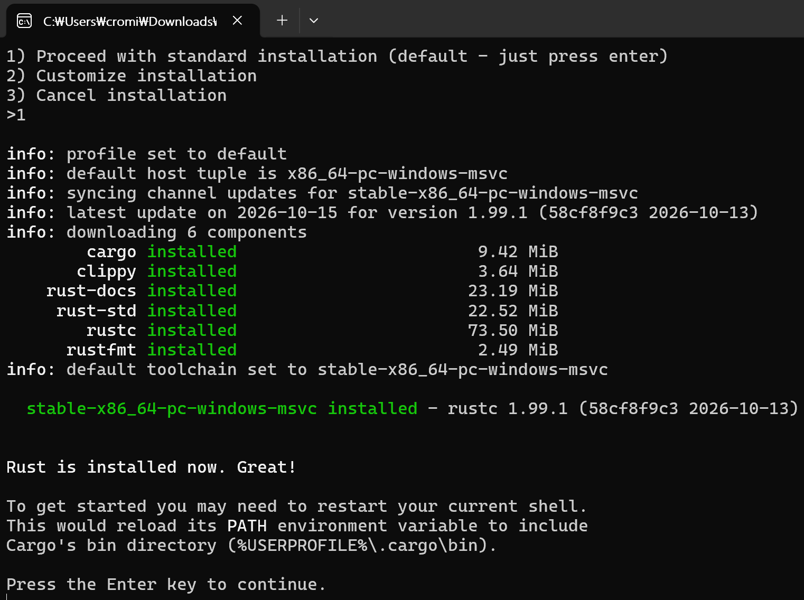

# 1.1. 설치
윈도우 사용자로 visual studio가 필요



rustup-init.exe로 총 6개의 컴포넌트 설치됨

컴포넌트:
* carge : Rust 패키지 관리자 및 빌드 시스템
* clippy : 코드 품질 정적 분석 도구 (린터)
* rust-docs : Rust 공식 문서 오프라인 데이터
* rust-std : Rust 표준 라이브러리
* rustc : Rust 공식 컴파일러
* rustfmt : 코드 스타일 자동 정렬 도구

# 1.2. 읽기/쓰기/컴파일/실행
적절히 디렉토리를 설정한 후 main.rs 파일로 저장

```rust
fn main() {
  println!("Hello, world!");
}
```
이후 설정한 디렉토리에서 파일을 읽음

```PowerShell
> rustc main.rs
> .\main.exe
Hello, world!
```

코드 설명
```rust
fn main() {

}
```
main이라는 함수를 정의(fn) > 소괄호 안에 매개변수 입력(이 코드에선 사용하지 않음) > 함수 본문{} 실행

```rust
    println!("Hello, world!");
```
들여쓰기 = 4칸 스페이스바 > ! 매크로 호출을 의미 > 문자열 넘겨줌 > 세미콜론 ; 표현식 끝

rustc 컴파일 > 파일 생성(.exe .pdb .rs)

# 1.3. 카고
카고 : 러스트 빌드 시스템 및 패키지 매니저

새 프로젝트 생성
```PowerShell
$ cargo new hello_cargo
$ cd hello_cargo
```
이후 toml파일과 src디렉토리의 main.rs 생성

프로젝트 빌드 및 실행
```PowerShell
$ cargo build
$ .\target\debug\hello_cargo.exe
```
이 컴파일과 실행을 간소화한 `cargo run` 명령어, 실행 파일 생성 단계를 건너뛰는`cargo check`

요약:
* cargo new로 새 프로젝트를 생성할 수 있습니다.
* cargo build 명령으로 프로젝트를 빌드할 수 있습니다.
* cargo run 명령어는 한 번에 프로젝트를 빌드하고 실행할 수 있습니다.
* cargo check 명령으로 바이너리를 생성하지 않고 프로젝트의 에러를 체크할 수 있습니다.
* 빌드로 만들어진 파일은 작성한 소스 코드와 뒤섞이지 않도록 target/debug 디렉터리에 저장됩니다.

# 정리
rustup 으로 최신 stable 버전 러스트를 설치하기
러스트를 새 버전으로 업데이트하기
로컬 설치된 문서 열어보기
직접 rustc를 사용해 ‘Hello, world!’ 프로그램을 작성하고 실행해 보기
일반적인 카고의 사용법으로 프로젝트를 생성하고 실행하기